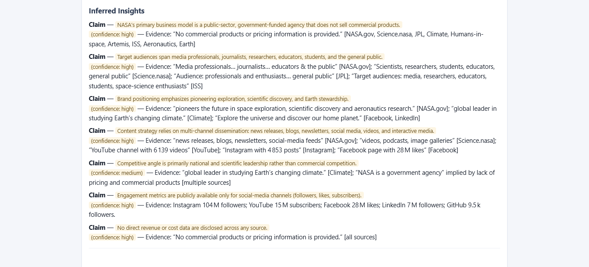
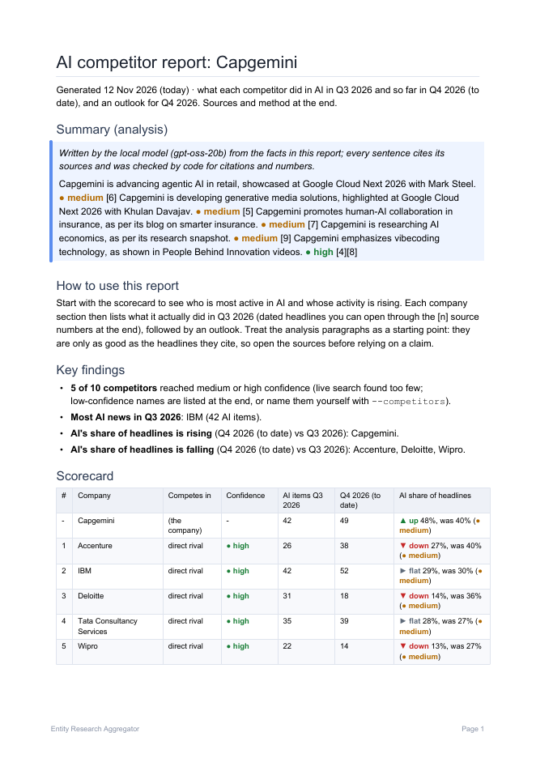
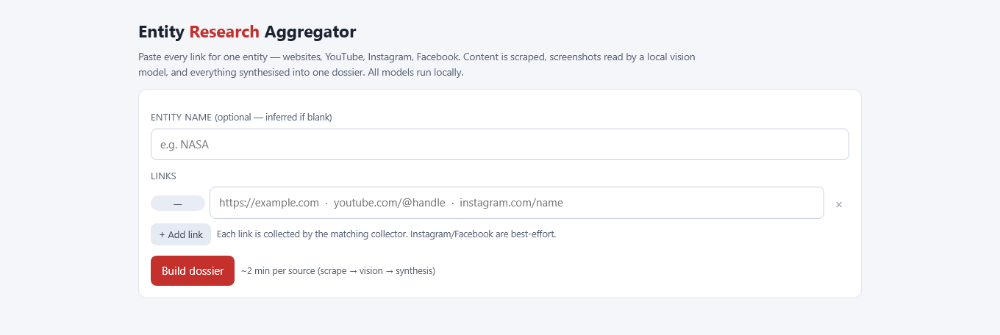
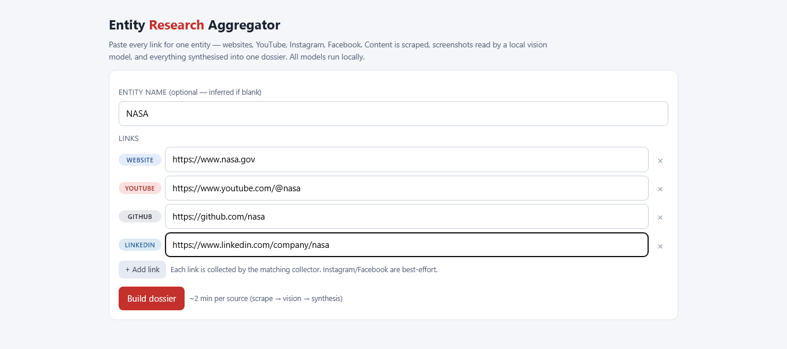
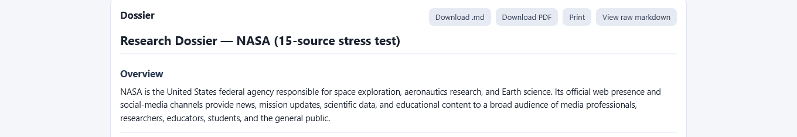
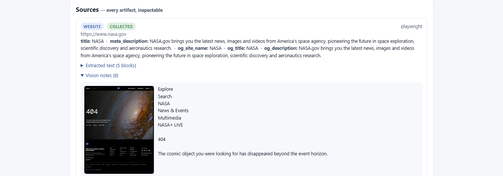
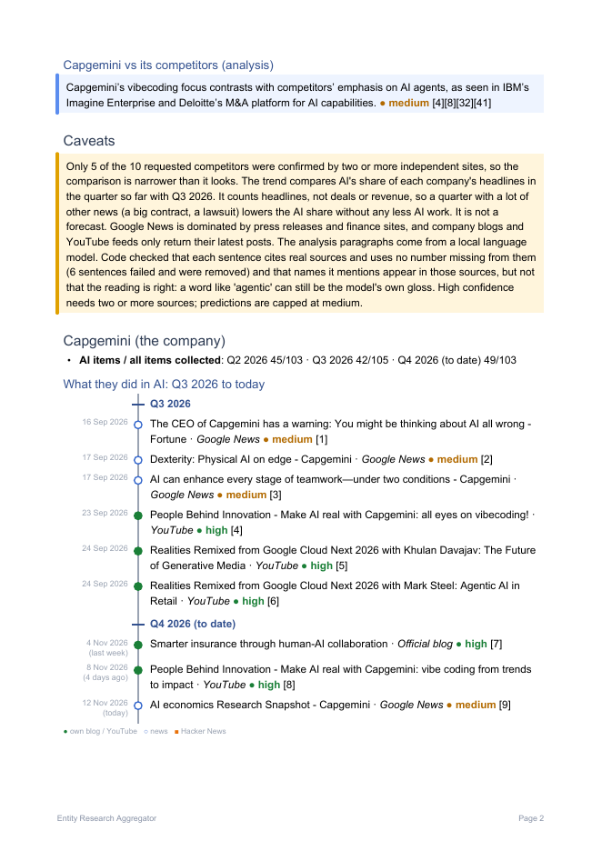
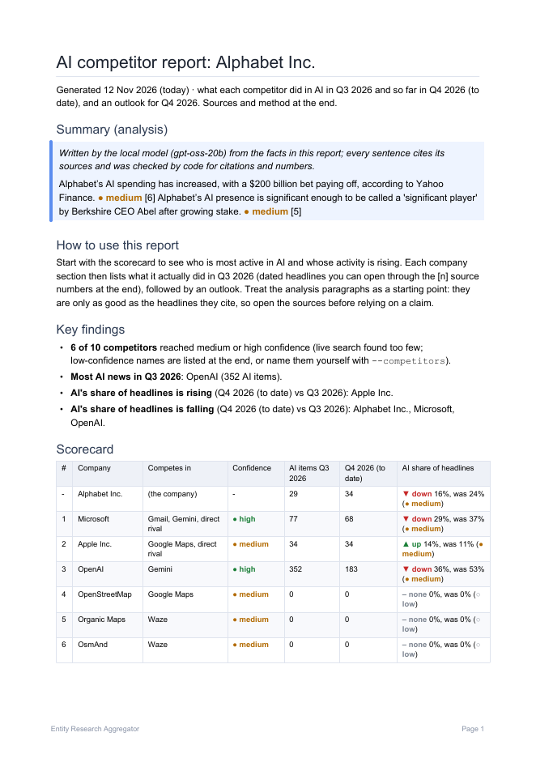
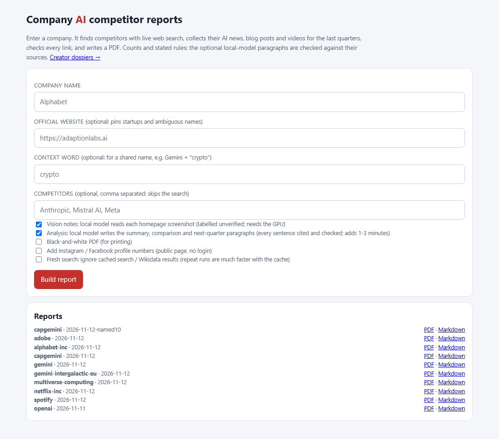
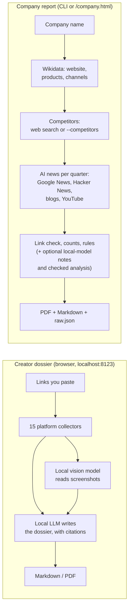

# 🕵️ Entity Research Aggregator

[](https://github.com/Pixiano/dapro-scraper-2026/actions/workflows/tests.yml)
[](LICENSE)


> *"I want to know everything about this YouTuber/creator/small company, but I refuse to open 16 tabs."* — me, constantly

> *"And what is this company's competition actually doing in AI, with links, not vibes?"* — also me

**A local-first research tool with two jobs:**

1. **Creator dossiers.** Paste links to a YouTuber, creator or small company (website, YouTube,
   Instagram, GitHub, Patreon, 15+ platforms). It scrapes each one, has a local vision model read
   the screenshots, and has a local LLM write one research dossier (Markdown or PDF) where every
   inferred claim carries a confidence level and a cited source.
2. **Company AI competitor reports.** Type a company name. It finds the competitors, collects what
   each one did in AI over the last quarters (news, Hacker News, blogs, YouTube), checks every
   link, and writes a PDF with a scorecard and a timeline per company.

Both run **on my own machine**: the AI models are local (llama.cpp), so no AI API key and no
per-token bill. The only things that leave the PC are the requests to the sites being researched,
plus optional search and YouTube API calls.

<table>
<tr>
<td width="50%"><br><sub>A creator dossier: every claim has a confidence and a quote.</sub></td>
<td width="50%"><br><sub>A company report: Capgemini vs its rivals (<a href="docs/examples/capgemini-report.pdf">full PDF</a>).</sub></td>
</tr>
</table>

<sub>Yes, this README has jokes in it. Yes, it also has real documentation. It's giving "built a whole app in one sitting and is still a little feral about it" energy, and honestly? Not sorry.</sub>

---

## Quick start

On Windows, with **Python 3.13**. In PowerShell, from the project folder:

```powershell
py -3.13 -m venv .venv
.venv\Scripts\python -m pip install -r requirements.txt
.venv\Scripts\python -m playwright install chromium
```

Create a file named `.env` in the project folder with one line (Wikidata refuses requests
without a contact; any URL or email of yours works):

```text
CONTACT_URL=https://github.com/your-name
```

Then run your first company report. This version needs no GPU and no model files, and takes about
a minute:

```powershell
.venv\Scripts\python -m backend.company "Capgemini" --no-vision --no-analysis --open
```

The PDF lands in `data/company/capgemini/<today>/report.pdf` and opens when it is done.

The full experience (creator dossiers, homepage notes and analysis paragraphs) needs the local
models: see [Full setup](#full-setup).

---

## Contents

- [Screenshots](#screenshots)
- [Creator dossiers](#creator-dossiers): how to use
- [Company AI competitor reports](#company-ai-competitor-reports): how to use, which option when, example output
- [How it works](#how-it-works)
- [The "wait, why should I trust this" section](#the-wait-why-should-i-trust-this-section)
- [Full setup](#full-setup): models, keys, where they go
- [Testing](#testing)
- [Repo layout](#repo-layout)
- [Known limitations](#known-limitations-being-honest-here-not-humble-bragging)
- [Troubleshooting](#troubleshooting)
- [Contact](#contact), [licence](#licence), war stories and about me

Deep reference: [docs/company-reports.md](docs/company-reports.md) (every option, how-tos, how to
read the report) and [docs/creator-dossiers.md](docs/creator-dossiers.md) (platform coverage,
architecture, HTTP API).

---

## Screenshots

### Creator dossiers

**The intake form.** Paste links, get instant platform auto-detection per link.


**Links filled in: badges auto-detect the platform per URL** (website / YouTube / GitHub / LinkedIn, etc.), so I know at a glance which collector will run on each one.


**A real generated dossier.** This one's from an actual 15-source run, all NASA.


**Every artifact is inspectable:** raw extracted text and the local vision model's actual read on every screenshot, including this genuinely delightful description of a 404 page.


### Company AI competitor reports

**Each company gets a timeline** of its AI headlines, oldest first: filled dot = its own blog or YouTube, hollow dot = news, square = Hacker News. Every line links to its source.


**Alphabet, found by search.** Note the honest bits: the map apps at the bottom are real Google Maps rivals with zero AI news, which is exactly what the scorecard says.


**The browser page**, for when typing flags is too much.


---

## Creator dossiers

1. **Start the server:** `.venv\Scripts\python -m uvicorn backend.main:app --port 8123`
2. **Open** `http://localhost:8123`.
3. **Paste links**, as many as I want, for one entity: website, YouTube, Instagram, Facebook,
   LinkedIn, GitHub, Medium, Substack, Reddit, X/Twitter, Linktree/Beacons/stan.store, Patreon,
   Ko-fi/Buy Me a Coffee, Twitch, or literally any other website (there's a generic fallback
   collector for that: no site left behind). Optionally give the entity a name.
4. **Click the big red button.** Go get a coffee: a real job with vision + synthesis on several
   sources genuinely takes a few minutes, because the GPU is doing actual work, not just vibing.
5. **Read the dossier** in the page, or click one button for a server-rendered PDF.

What happens in between:

- **Each link is scraped** with a purpose-built collector per platform (not just "screenshot and
  pray"): real API calls where APIs exist (YouTube, GitHub, Reddit's JSON endpoints), structured
  data where it's hiding in the page (LinkedIn's JSON-LD, Patreon's embedded JSON:API blob), RSS
  where that's the sane option (Medium, Substack), and a headless-browser render for everything
  else.
- **A news feed comes free:** if I gave it an entity name, it auto-attaches a Google News search
  for that name. I didn't even ask. It just does it. Overachiever.
- **A local vision model reads every screenshot.** Not to transcribe text I already scraped
  (that's how you get an AI confidently telling you a YouTuber has "451K views" when it's actually
  451; true story, ask me how I know), but to describe layout, branding and vibe, and to read the
  stuff that genuinely only exists as pixels (login-walled social previews, infographics,
  thumbnails).
- **A local reasoning LLM writes the dossier:** factual findings per source, plus an "Inferred
  Insights" section on business model, audience, positioning and monetization, where **every
  single claim carries a confidence level and a cited quote**. If it doesn't know, it says so in
  Gaps & Caveats instead of making something up.

Which platforms are covered and how: [docs/creator-dossiers.md](docs/creator-dossiers.md).

---

## Company AI competitor reports

### How to use

1. **Run it** with a company name:

   ```powershell
   .venv\Scripts\python -m backend.company "Capgemini"
   ```

2. **Watch the progress:** one line per stage with the elapsed time (resolve, competitors,
   collect, vision, report). A full run takes about 2-7 minutes. Ctrl+C stops it cleanly.
3. **Read the summary** it prints at the end: the competitors with their confidence, AI items per
   quarter per company, link stats, and where the PDF is.
4. **Open the PDF** (`--open` does that for you on Windows). Start with the scorecard: who is most
   active in AI, and whose AI share of headlines is rising. Then each company's timeline. How to
   read every part: [docs/company-reports.md#how-to-read-the-report](docs/company-reports.md#how-to-read-the-report).

Or in the browser: start the server (step 1 above) and open `http://localhost:8123/company.html`.
Type a company, click *Build report*, and the PDF opens when it is done.

### Which option when

| Situation | Use | Why |
|---|---|---|
| You know who the rivals are | `--competitors "A,B,C"` | Skips the search. The most reliable list, and faster. |
| A startup, or a name several companies share | `--url https://...` | Pins the company by its website on Wikidata ("Gemini" + gemini.com is the crypto exchange, not the Google model). |
| The name still pulls in other people's news | `--context WORD` | That word must appear in news and search results: `"Gemini" --url https://www.gemini.com --context crypto` |
| Slow, or the PC is low on memory | `--no-vision --no-analysis` | Skips both local models: about 10-60 seconds instead of 2-7 minutes. Counts and timelines stay. |
| Too few rivals found | `BRAVE_API_KEY` in `.env` | Adds Brave to DuckDuckGo. Paid; see [the how-to](docs/company-reports.md#get-more-competitors-set-the-brave-key). |
| Printing on a black-and-white printer | `--bw` | Same report in greys; words and shapes carry the meaning. |
| Want Instagram/Facebook follower numbers | `--social` | Public profile page only, no login; never in the counts. |
| Fewer or more rivals | `--top N`, `--categories N`, `--per-category N` | Defaults 10, 5 and 3. |
| A repeat run should search again | `--fresh` | Ignores the 24 h search / 30 day Wikidata cache once. |
| Something failed and you want to know why | `--debug` | Full traceback instead of a one-line error. |

The CLI prints the same advice: run `.venv\Scripts\python -m backend.company --help` (or the
command with no arguments) for every option with examples, and each run starts with tips for the
options you did not use. The full `--help` text is in
[docs/company-reports.md](docs/company-reports.md#all-options).

### How-tos

Step-by-step guides in [docs/company-reports.md](docs/company-reports.md#how-tos):

- [Run a company report](docs/company-reports.md#run-a-company-report)
- [Name the competitors yourself](docs/company-reports.md#name-the-competitors-yourself)
- [Report on a startup, or a name several companies share](docs/company-reports.md#report-on-a-startup-or-a-name-several-companies-share) (`--url`, `--context`)
- [Run faster, or on a PC low on memory](docs/company-reports.md#run-faster-or-on-a-pc-low-on-memory) (`--no-vision --no-analysis`)
- [Get more competitors: set the Brave key](docs/company-reports.md#get-more-competitors-set-the-brave-key)
- [Print in black and white](docs/company-reports.md#print-in-black-and-white) (`--bw`)
- [Use the browser page instead](docs/company-reports.md#use-the-browser-page-instead)
- [How to read the report](docs/company-reports.md#how-to-read-the-report): the scorecard, the confidence badges, the share-of-headlines trend, the appendix
- [Run the tests and the live scenario suite](#testing) (in this README)

### Example output

The end of a real run (`python -m backend.company "Alphabet"`, all options on; my folder path
shortened to `...`):

```text
Done in 2:40.
Competitors (6):
  Microsoft                    high
  Apple Inc.                   medium
  OpenAI                       high
  OpenStreetMap                medium
  Organic Maps                 medium
  OsmAnd                       medium

Items per quarter:
                                Q2 2026   Q3 2026  Q4 2026 (to date)
  Alphabet Inc.                     185       123       212
  Microsoft                         213       206       234
  Apple Inc.                        262       306       248
  OpenAI                            471       659       462
  OpenStreetMap                       8        11         3
  Organic Maps                        5         5         1
  OsmAnd                             37        26        86

Links: 160 live, 9 unverified
Time:  resolve 0s, competitors 2s, collect 18s, vision 26s, report 113s

Report: ...\Scraper\data\scenarios\general\alphabet-inc\2026-11-12\report.pdf
        (raw data in ...\Scraper\data\scenarios\general\alphabet-inc\2026-11-12)
Open it:  ii "...\Scraper\data\scenarios\general\alphabet-inc\2026-11-12\report.pdf"   (PowerShell; or add --open next time)
```

"Items per quarter" counts everything collected; the PDF then filters it down to the AI items.
A full example report: [docs/examples/capgemini-report.pdf](docs/examples/capgemini-report.pdf)
(13 pages; competitors found by search with the Brave key: Accenture, IBM, Deloitte, Tata
Consultancy Services and Wipro).

### What to expect (the honest part)

- **Search alone finds few rivals.** DuckDuckGo found 2 for Capgemini; with the Brave key, 5 of
  the 10 requested. The list you name with `--competitors` is the most reliable one.
- **A rival named by 3+ different websites is high confidence, 2 is medium, 1 is low.** Low names
  go to an appendix at the back, not the main list. A product counts under its maker (a site
  naming ChatGPT gives OpenAI, shown "via ChatGPT").
- **The trend is AI's share of a company's headlines** this quarter so far vs last quarter (a
  change of more than 20% is up or down). It is a stated rule, not a forecast, and it counts
  headlines, not deals or revenue.
- **The analysis paragraphs come from a local model** and are checked by code: a sentence without
  a valid citation, with a number not in the facts, or naming something its sources do not
  mention is removed.
- **Some results are still wrong:** Lectra shows up as a Nestlé rival (it competes with a
  different company called Gerber), map apps with no AI news show up as Alphabet rivals, and the
  low-confidence appendix contains some junk names.

More: [known limits and wrong results](docs/company-reports.md#known-limits-and-wrong-results).

---

## How it works

Both mechanisms share one FastAPI server, one SQLite cache, Playwright for screenshots and one
local model server, but they are separate pipelines.



**Creator dossiers:** FastAPI + a single-worker job queue (one GPU, so one model loaded at a
time: vision and synthesis take turns), SQLite for job state, caching and the YouTube quota
ledger, Playwright + httpx + BeautifulSoup for scraping, and llama.cpp's `llama-server` running
Qwen3.5 (vision) and gpt-oss-20b (synthesis). Full architecture and the HTTP API:
[docs/creator-dossiers.md](docs/creator-dossiers.md).

**Company reports:** every number is a count and every outlook a stated rule. The models are
optional extras whose output is labelled and never feeds a count. The step-by-step pipeline,
with what each source contributes and every rule:
[docs/company-reports.md#how-it-works-step-by-step](docs/company-reports.md#how-it-works-step-by-step).

---

## The "wait, why should I trust this" section

Fair question. Here's what I specifically built in to stop this thing from confidently lying to me:

- **Text-first, vision-as-a-backup.** If I already scraped a page's real text, the vision model is told to describe the *design*, not re-read the words, because re-reading them is exactly how numbers get hallucinated. (See: the entire 451-vs-451K incident above. I learned. Painfully.)
- **Every inference needs receipts.** The dossier prompt doesn't let the model write "they probably make $10K/month" with nothing backing it: it has to be `**Claim** — (confidence: medium) — Evidence: "quote from a real source" [platform]`, or it doesn't go in.
- **The company reports don't trust the model either.** The model only ever sees the report's own headlines and counts, and code deletes every sentence it can't trace back to them. The numbers themselves never come from a model at all.
- **Failures are boring on purpose.** If a source 404s, gets rate-limited, or a platform decides my IP looks like a robot (rude, but fair, it is a robot), the dossier just says *"No notable public information found."* It will never print "HTTP 403" or a stack trace into my nice research document. That stuff lives in the debug view where it belongs.
- **No login automation, anywhere.** Instagram, Facebook, LinkedIn, Reddit, Patreon: all logged-out, best-effort, public-data-only. I'm not trying to get my account banned or my IP blacklisted. Some sources will come back thin. That's the deal with polite scraping, and I think it's the right one.

---

## Full setup

You'll need: **Python 3.13**, and for the local models **an NVIDIA GPU with ~16GB VRAM** (built and tuned against an RTX 5060 Ti; smaller cards may need lighter models), plus patience for one big model download if you don't already have GGUFs sitting around from LM Studio or similar. The company reports run without a GPU when you pass `--no-vision --no-analysis`.

### 1. Python packages and the browser

```powershell
cd Scraper
py -3.13 -m venv .venv
.venv\Scripts\python -m pip install -r requirements.txt
.venv\Scripts\python -m playwright install chromium
```

### 2. Keys: where they go

Everything goes in one file named `.env` in the project folder. It is git-ignored, so keys never
end up on GitHub. One `NAME=value` per line, no quotes needed:

```text
CONTACT_URL=https://github.com/your-name
YOUTUBE_API_KEY=
BRAVE_API_KEY=
```

| Key | Needed? | What for |
|---|---|---|
| `CONTACT_URL` | **Yes**, for anything that touches Wikidata (all company reports) | Wikimedia's API rules require a contact in the User-Agent and answer 403 without one. A URL or an email. Sent only to Wikimedia. |
| `YOUTUBE_API_KEY` | Optional | Creator dossiers: the YouTube collector. Company reports: full upload history instead of the latest 15 videos from RSS. |
| `BRAVE_API_KEY` | Optional, **paid** | Company reports: adds Brave Search to DuckDuckGo, which finds more competitors. No free plan (card required; about $5 of searches a month included). |

**No AI key anywhere.** The models are local.

**YouTube key (free, ~3 minutes, no credit card):** Google Cloud console → new project → enable
*YouTube Data API v3* → Credentials → Create API key → **restrict it** to that API only. That gets
you 10,000 free quota units a day, which is genuinely a lot: the app also caches aggressively and
never touches the expensive `search.list` endpoint unless you explicitly ask it to.

### 3. Local models (llama.cpp)

Download a [llama.cpp release](https://github.com/ggml-org/llama.cpp/releases) build matching
your CUDA version and drop `llama-server.exe` + its DLLs into `tools/llamacpp/` (git-ignored).
The model files are looked up under LM Studio's default folder (`~/.lmstudio/models`):

- **Vision:** `unsloth/Qwen3.5-4B-GGUF/Qwen3.5-4B-Q6_K.gguf` + `mmproj-BF16.gguf` from the same folder
- **Text:** `lmstudio-community/gpt-oss-20b-GGUF/gpt-oss-20b.gguf`

If you already grabbed these via LM Studio, you may not need to change anything. Otherwise point
`.env` at your files: `LMSTUDIO_MODELS_DIR`, `LLM_VISION_MODEL`, `LLM_VISION_MMPROJ`,
`LLM_TEXT_MODEL` (relative to the models folder, or absolute), and `LLAMA_SERVER_EXE`. All
defaults are in `backend/config.py`. The app starts and stops the model server itself, on port
8080 (`LLM_PORT`).

### 4. Run it

```powershell
.venv\Scripts\python -m uvicorn backend.main:app --port 8123
```

Creator dossiers at `http://localhost:8123`, company reports at
`http://localhost:8123/company.html` or from the CLI (`python -m backend.company`).

---

## Testing

```powershell
.venv\Scripts\python -m pytest -q
```

263 tests, fully offline (everything's mocked: no real network calls, no GPU spin-up), runs in
about 2 seconds. If the suite ever takes suspiciously longer than that, something snuck a real
network/model call into a unit test again. I've caught myself doing this more than once. Type
checks: `.venv\Scripts\python -m mypy backend` (both run in CI on every push, see
`.github/workflows/tests.yml`).

**Live tests** are marked `@pytest.mark.live` and excluded by default (`pytest.ini` has
`addopts = -m "not live"`), so they never run in CI. Run them explicitly:

| Command | What it runs | Needs | Time |
|---|---|---|---|
| `.venv\Scripts\python -m pytest -m live tests/test_live_integration.py` | 4 tests: a real Chromium fetch of `example.com`, a real GitHub API call, a real YouTube API call (skipped without a key), one real company pipeline run | network, Chromium | about 40 s |
| `.venv\Scripts\python -m pytest -m live tests/test_live_integration.py -k company` | only the company pipeline run | network | about 20 s |
| `.venv\Scripts\python -m pytest -m live tests/test_company_scenarios.py` | **the live scenario suite**: 16 real CLI runs | network, local models; uses Brave searches if the key is set | 30-45 min |

The **scenario suite** runs the real CLI for one general case (Alphabet) and 15 variants, each
flipping one branch: named rivals, a startup with `--url`, a shared name with `--context`, a
company with only subsidiaries (Capgemini), small limits, a company that does not exist, each
flag (`--no-analysis`, vision only, `--bw`, `--social`, `--fresh`), and odd names (lowercase,
"Nestlé", "AT&T", "Apple" the fruit or the company). Each writes to `data/scenarios/<name>/`
with a `cli.log` and a `result.json`, and every report is checked against the same rules
(citations, duplicates, flags, competitor list). A scenario already finished today is not rerun,
so an interrupted suite picks up where it stopped.

Careful: `pytest -m live -k company` without a file name also matches the scenario module, so it
starts all 16 scenarios.

---

## Repo layout

```text
backend/
  main.py, worker.py, jobs.py   FastAPI app, job queue, job store (creator dossiers)
  pipeline.py                   creator dossier pipeline: collect -> vision -> synthesis
  collectors/                   one collector per platform (+ generic website fallback)
  vision.py, synthesis.py       local-model stages for the dossiers
  llm/                          llama-server start/stop and client
  youtube/, instagram/          YouTube Data API client + quota, Instagram lookup
  pdf.py                        Markdown -> PDF (ReportLab), shared by both mechanisms
  cache.py, quota.py, config.py SQLite cache, YouTube quota ledger, settings from .env
  company/                      company AI competitor reports
    __main__.py                 the CLI (python -m backend.company)
    pipeline.py                 the five steps, shared by the CLI and the browser page
    wikidata.py                 resolve the company, its links and products
    competitors.py              competitor search and confidence
    collect.py, social.py       news, Hacker News, blogs, YouTube; --social
    visual.py, analysis.py      optional local-model vision notes and checked analysis
    linkcheck.py, report.py     link checks; the report, scorecard and timelines
    web.py                      /api/company routes behind company.html
frontend/                       index.html (dossiers), company.html, app.js, style.css
tests/                          offline tests + live tests (test_live_integration.py,
                                test_company_scenarios.py)
scripts/                        one-off tools: screenshot capture, vision bench, LLM smoke test
docs/                           guides, screenshots, an example report, old plans (docs/plans/)
data/                           everything the app writes (git-ignored)
tools/llamacpp/                 llama-server binaries (git-ignored, download separately)
```

The planning documents from earlier phases (the original spec, the V2 plan, the company plan,
future ideas, an unimplemented ngrok hosting plan) are kept in [docs/plans/](docs/plans/) for
history; the code and these docs are the current truth.

---

## Known limitations (being honest here, not humble-bragging)

- **Reddit, Instagram, Facebook, LinkedIn, Patreon, Ko-fi** are all logged-out best-effort. Sometimes they'll give you everything, sometimes they'll give you nothing and a shrug. This is the nature of scraping platforms that actively don't want to be scraped, and I chose "degrade gracefully" over "log in and risk getting banned."
- **TikTok** isn't supported. It's geo-blocked from my dev machine and thin logged-out anyway. Recognized as a valid future addition, not implemented.
- **No server-side video/audio analysis.** It reads pixels and text, not sound.
- **Company reports count headlines**, and search finds too few rivals on its own; some rivals it finds are wrong (see [What to expect](#what-to-expect-the-honest-part)). The AI filter is a keyword list, not a classifier.
- **Windows-first.** Built and run on Windows 11; `--open` and the model-server cleanup are Windows-only.
- **This is a research tool, not a mass-surveillance tool.** It's built for looking up one entity at a time from links you already have. Please don't point it at thousands of people. Also: be a decent human about what you do with the output.

See [`docs/plans/suggestions.txt`](docs/plans/suggestions.txt) for the "here's what I'd build next" list (GitHub deeper-dive, comparison mode for 2+ entities, custom research questions, scheduled re-runs to track changes over time, and more).

---

## Troubleshooting

| Symptom | Cause | Fix |
|---|---|---|
| Company report: only one or two competitors, or none | DuckDuckGo alone returns few results, and throttles repeated runs | Name them: `--competitors "A,B,C"`. Or set `BRAVE_API_KEY` in `.env` (paid). |
| `nothing found for 'X': check the spelling or add --url https://...` | No news or posts matched the name | Check the spelling; add `--url` with the official site; for a shared name add `--context WORD`. |
| `not on Wikidata: searched as a startup` for a small company | Normal: many startups have no Wikidata entry | Add `--url https://...` so the right site is used. |
| `not on Wikidata: searched as a startup` for a well-known company (Alphabet, Capgemini) | `CONTACT_URL` is missing from `.env`: Wikimedia answers HTTP 403 without a contact in the User-Agent, and the lookup fails quietly | Put `CONTACT_URL=...` (a URL or email) in `.env` and run again (failed lookups are never cached). |
| The PC runs out of memory, or the run is killed | The local models are big (gpt-oss-20b, Qwen3.5) | `--no-vision --no-analysis` skips both models; the counts and timelines are unchanged. |
| `warning: network errors (offline?); the report may be empty` | No internet connection, or a site refused the connection | Check the connection and run again. |
| Vision notes say `unavailable`, or a Playwright error mentions a missing executable | Chromium for Playwright is not installed | `.venv\Scripts\python -m playwright install chromium` |
| Caveats say "The local model analysis was unavailable this run", or dossiers fail at the vision/synthesis stage | The model server did not start: `llama-server not found`, `Model file missing`, `Vision projector missing`, or `did not become healthy in time` | Put `llama-server.exe` and its DLLs in `tools/llamacpp/` (or set `LLAMA_SERVER_EXE`); check the model paths ([Full setup](#3-local-models-llamacpp)); a slow first load may need a larger `LLM_START_TIMEOUT_S` (default 180). Or skip the models with `--no-vision --no-analysis`. |
| Each run costs Brave searches, even a repeat | Deliberate: while `BRAVE_API_KEY` is set nothing is cached, because Brave's terms forbid storing results | Expected. Remove the key to get the 24 h cache back (DuckDuckGo only). |
| Brave sign-up asks for a card | Brave's Search API has no free plan; about $5 of searches a month are included | Optional: without it, search is DuckDuckGo only. |
| A repeat run finds the same (wrong) rivals | Search results are cached for 24 hours, Wikidata for 30 days | `--fresh` for one uncached run. |
| `error: SomeError: ...` and nothing else | Errors print as one line by default | Rerun with `--debug` for the full traceback, and open an [issue](https://github.com/Pixiano/dapro-scraper-2026/issues) if it looks like a bug. |
| The offline test suite takes more than a few seconds | A test is making a real network or model call | Find it and mock it; live tests belong under `@pytest.mark.live`. |

---

## Skills demonstrated

Mostly here for the "what does this actually show I can do" crowd: recruiters, future-me, whoever.

- **Backend architecture:** FastAPI, async job orchestration with a single-worker queue (deliberate: one GPU, one model resident at a time), SQLite for job state/caching/quota tracking.
- **LLM integration & prompt engineering:** local model orchestration via llama.cpp, grounded output design (every synthesized claim requires cited evidence), role-aware prompting (different instructions depending on whether text was already scraped or only exists as pixels), and code that checks model output against its sources and deletes what fails.
- **Web scraping at scale:** 15 platform-specific collectors using whatever's actually reliable per site (REST APIs, RSS, embedded JSON blobs, JSON-LD, headless-browser rendering) plus a generic fallback so no site is unsupported; Wikidata entity resolution and multi-engine competitor search for the company reports.
- **Security-conscious design:** path-traversal-safe file serving, rate limiting, no credential/login automation anywhere, sanitized error handling (raw errors never reach either the AI prompt or the end document).
- **Testing discipline:** 263 offline tests in about 2 seconds, plus a 16-scenario live suite that checks every generated report against the same rules.
- **Debugging under real constraints:** several of the war stories below involved reverse-engineering undocumented third-party JSON shapes (Patreon) and diagnosing silent failures in a local inference stack with no error messages to go on.

---

## A brief, honest "war stories" section

Because a README with zero personality is a crime against README-kind:

- **The Great Screenshot Disappearing Act:** llama.cpp silently drops oversized images instead of erroring. I spent a while wondering why the vision model was "reading" a 7000px-tall screenshot and returning nothing, before realizing the image never actually made it to the model. It just... vanished. Into the void. No apology, no explanation. Fixed by downscaling everything to a sane size first.
- **The AI Almost Leaked Its Inner Monologue Into a Professional Document:** gpt-oss is a reasoning model, and when it runs out of tokens mid-thought, it can return its raw internal reasoning instead of a final answer. My first version had a fallback that would print that reasoning straight into the dossier if the real answer was empty. Which meant, briefly, a research document could open with something like *"Okay, I need to figure out what this creator does..."* instead of, y'know, an actual answer. Extremely unprofessional. Fixed.
- **Ko-fi's soft-404s:** a "successful" 200 response that's secretly just the homepage in a trench coat. Caught and reported as "not a real profile".
- **The Gemma vs. Qwen Vision Showdown:** I didn't just pick a vision model and hope. Ran an actual head-to-head bake-off on a real screenshot and one model straight-up invented a YouTuber named "PowerDog." Not making that up. It's in the git log if you don't believe me.

---

## Contact

- GitHub: [@Pixiano](https://github.com/Pixiano)
- Bugs, questions and ideas: [open an issue](https://github.com/Pixiano/dapro-scraper-2026/issues)

## Licence

[MIT](LICENSE). Use it, fork it, remix it, sell it if you're bold; just keep the copyright notice. No warranty, no liability, standard stuff.

## About me

I'm 15, I run on caffeine-adjacent energy drinks and main-character delusion, and I half-jokingly refer to myself as an "AI god" 😅 — mostly because I will absolutely rebuild an entire pipeline at 1am over a vision-model hallucination out of pure spite. This is a solo hobby project, built because I wanted it to exist and nobody else was going to build it for me. If you find bugs, no you didn't. If you find something cool, that one was on purpose.

— vatsaldapro
