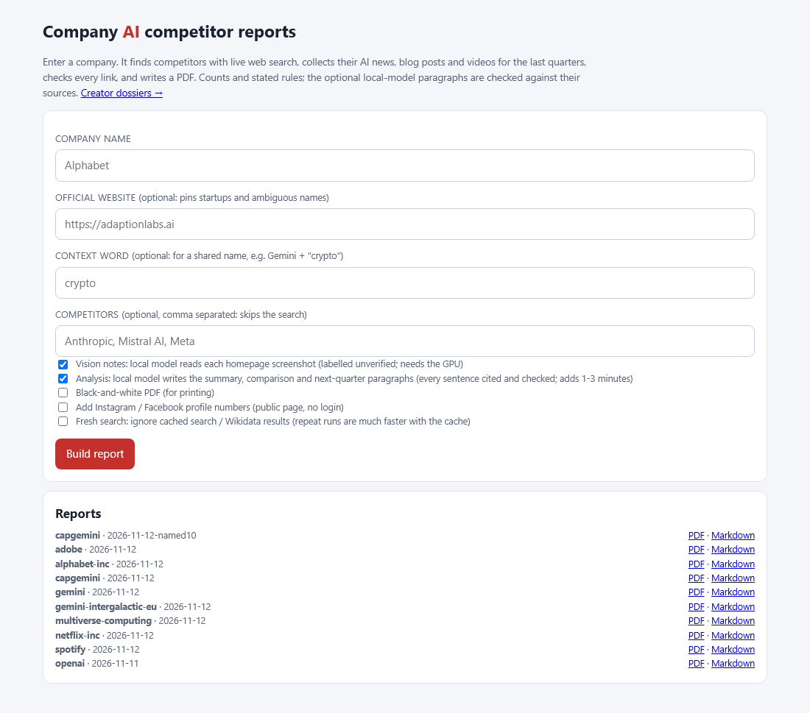
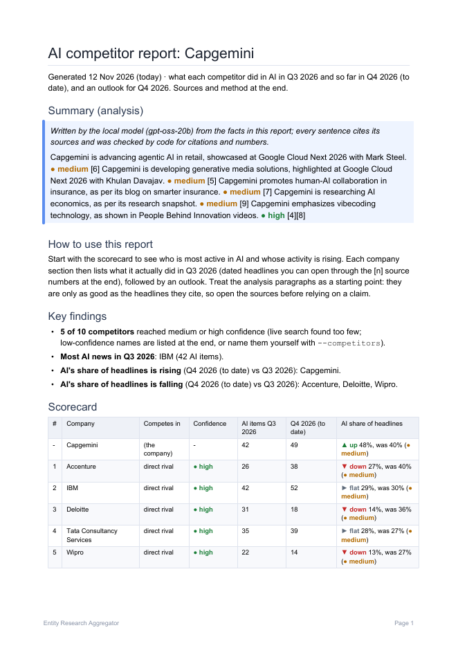
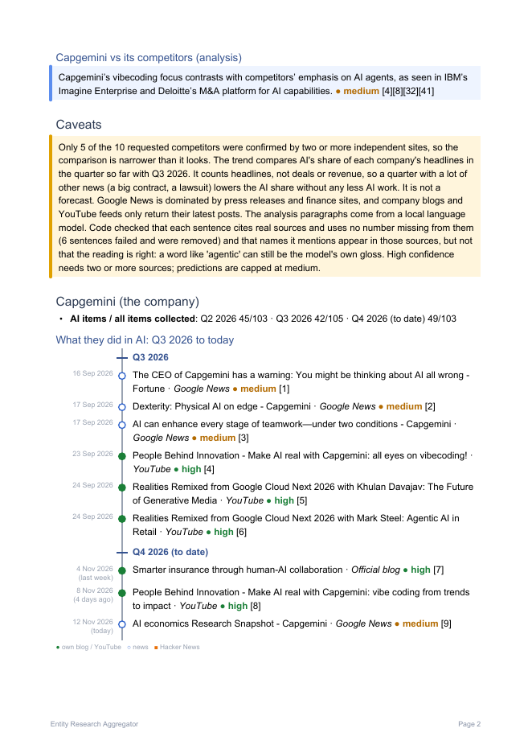
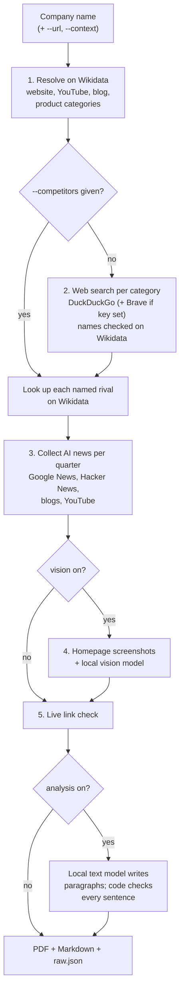

# Company AI competitor reports: the full guide

The short version is in the [README](../README.md#company-ai-competitor-reports). This page has
everything else: every option, step-by-step how-tos, how to read the PDF, exactly how each number
is made, and what still goes wrong.

All commands are for Windows PowerShell, run from the project folder, with the virtual
environment from the README's [Quick start](../README.md#quick-start).

**Contents**

- [What you get](#what-you-get)
- [All options](#all-options)
- [How-tos](#how-tos)
- [How to read the report](#how-to-read-the-report)
- [How it works, step by step](#how-it-works-step-by-step)
- [Speed](#speed)
- [Known limits and wrong results](#known-limits-and-wrong-results)

---

## What you get

One command, one company:

```powershell
.venv\Scripts\python -m backend.company "Capgemini"
```

The tool then:

1. looks the company up on [Wikidata](https://www.wikidata.org) (the free, structured sister of
   Wikipedia) to get its official website, YouTube channel, blog and main products;
2. finds its competitors by web search, or takes the ones you name;
3. collects what each company did in AI over the last two quarters and this quarter so far, from
   Google News, Hacker News, the company's own blog and its YouTube channel;
4. optionally screenshots each homepage and has a **local** vision model list the AI products on
   it;
5. checks every link, optionally has a **local** text model write short analysis paragraphs
   (checked sentence by sentence by code), and writes a PDF.

Everything lands in `data/company/<company>/<date>/`:

| File | What it is |
|---|---|
| `report.pdf` | The report. [Example: Capgemini, 13 pages](examples/capgemini-report.pdf). |
| `report.md` | The same report as Markdown. |
| `raw.json` | Every item, link, HTTP status and check time, for auditing. |
| `analysis_raw.txt` | The text model's raw reply, before the code checks (only when analysis ran). |
| `screenshots/` | The homepage screenshots the vision model looked at (only when vision ran). |

A repeat run on the same day writes into the same folder.

---

## All options

This is the real `--help` output:

```text
usage: python -m backend.company [-h] [--url URL] [--context WORD]
                                 [--competitors "A,B"] [--categories N]
                                 [--per-category N] [--top N] [--no-vision]
                                 [--no-analysis] [--social] [--bw] [--open]
                                 [--fresh] [--debug]
                                 name

Build a PDF report on a company's AI activity vs its competitors.

positional arguments:
  name                 company name, e.g. Alphabet

options:
  -h, --help           show this help message and exit

which company and rivals:
  --url URL            official website; pins the company (startups, ambiguous
                       names)
  --context WORD       extra word required in news/search for a shared name,
                       e.g. "Gemini" --context crypto
  --competitors "A,B"  skip the competitor search: "OpenAI,Anthropic"
  --categories N       top N product categories to search (default 5)
  --per-category N     competitors per category (default 3)
  --top N              competitors overall (default 10)

what goes in the report:
  --no-vision          skip the homepage screenshots + local vision model
                       notes
  --no-analysis        skip the local-model analysis paragraphs (summary,
                       meaning, next quarter)
  --social             add Instagram/Facebook profile summaries (public page,
                       no login)

output and run:
  --bw                 black-and-white PDF (printing)
  --open               open the PDF when done
  --fresh              ignore cached search/Wikidata results (24 h / 30 d) for
                       this run
  --debug              show full tracebacks on errors

examples:
  python -m backend.company "Alphabet"
  python -m backend.company "Adaption Labs" --url https://adaptionlabs.ai
  python -m backend.company "OpenAI" --competitors "Anthropic,Mistral AI" --no-vision
  python -m backend.company "Gemini" --url https://www.gemini.com --context crypto --open

A full run takes 2-7 minutes; --competitors, --no-vision and --no-analysis make it faster.
Output: data/company/<company>/<date>/report.pdf (+ report.md, raw.json).

which option when:
  know the rivals?         --competitors "A,B"   (the most reliable list)
  startup or shared name?  --url https://...   (and --context WORD)
  slow, or low on memory?  --no-vision --no-analysis
  few rivals found?        put BRAVE_API_KEY=... in the .env file (without it, search is DuckDuckGo only)
```

Started with no arguments, the command prints this help instead of an error. At the start of a
run it prints the "which option when" tips for the options you did not use.

---

## How-tos

### Run a company report

```powershell
.venv\Scripts\python -m backend.company "Alphabet" --open
```

You will see one line per stage, with the elapsed time:

```text
Building the AI report for 'Alphabet' (usually 2-7 min; Ctrl+C to stop)
[0:00] 1/5 resolve      looking up 'Alphabet' on Wikidata
[0:00]                found Alphabet Inc. (Q20800404), 5 product categories
[0:00] 2/5 competitors  web search per category (~15 s each)
[0:02] 3/5 collect      news, blogs, YouTube for 7 companies
[0:20] 4/5 vision       homepage screenshots + local vision model
[0:46] 5/5 report       link checks, local-model analysis, PDF
```

(The competitor step took 2 seconds here because the search results were cached from an
earlier run.) When it finishes it prints a summary; the full example is in the
[README](../README.md#example-output). `--open` opens the PDF on Windows; without it, the last
line prints a PowerShell command (`ii "<path>"`) that opens it. Ctrl+C stops the run cleanly. An
error prints as one line; add `--debug` to see the full traceback.

### Name the competitors yourself

Web search finds fewer rivals than you would expect (see [Speed](#speed) and
[limits](#known-limits-and-wrong-results)). If you already know who the rivals are, say so. This
skips the search entirely and is the most reliable list you can get:

```powershell
.venv\Scripts\python -m backend.company "OpenAI" --competitors "Anthropic,Mistral AI,Meta"
```

Separate the names with commas. Each name is still looked up on Wikidata to find its website,
blog and YouTube channel. Names with punctuation work: `--competitors "AT&T,T-Mobile US"`.

### Report on a startup, or a name several companies share

A startup is often not on Wikidata, and a name like "Gemini" means a crypto exchange, a Google
model and a constellation. Pin the company by its website with `--url`:

```powershell
.venv\Scripts\python -m backend.company "Adaption Labs" --url https://adaptionlabs.ai
```

With `--url`, a Wikidata match is only trusted if its listed website matches. If the company
is not on Wikidata at all, it is searched as a startup, by its name.

If the name still pulls in other people's news, add `--context` with one word that the right
company's headlines contain. That word is then required in news and search results:

```powershell
.venv\Scripts\python -m backend.company "Gemini" --url https://www.gemini.com --context crypto
```

If the plain name means something else on Wikidata, the report says so in its caveats.

### Run faster, or on a PC low on memory

The two optional steps that load local models are the slow and memory-hungry ones. Skip both:

```powershell
.venv\Scripts\python -m backend.company "Capgemini" --no-vision --no-analysis
```

That takes about 10-60 seconds instead of 2-7 minutes. The report keeps every count, timeline,
confidence badge and rule-based outlook; it only loses the homepage notes and the written
analysis paragraphs. Adding `--competitors` also saves the search time.

### Get more competitors: set the Brave key

Without a key, competitor search uses DuckDuckGo only (through the `ddgs` package), which returns
few results. For Capgemini it found 2 competitors; with the Brave key the same search found 5 of
the 10 requested (Accenture, IBM, Deloitte, Tata Consultancy Services and Wipro, all high
confidence). When a key is set, Brave and DuckDuckGo are both searched and the results merged.

1. Sign up for the [Brave Search API](https://brave.com/search/api/). There is no free plan: a
   card is required, and the plan includes about $5 of searches a month.
2. Create an API key.
3. Add it to the `.env` file in the project folder (create the file if it does not exist; it is
   git-ignored):

   ```text
   BRAVE_API_KEY=your-key-here
   ```

Use one key only: several accounts break Brave's terms. While a Brave key is set, search results
are deliberately **not cached** (Brave's terms forbid storing results), so every run searches
again and costs searches.

### Print in black and white

```powershell
.venv\Scripts\python -m backend.company "Capgemini" --bw
```

Same report, in greys. Words and shapes carry the meaning that colour carried: the badges say
"high", "medium", "low", "up", "down" in text, and the timeline still uses filled dots, hollow
dots and squares.

### Use the browser page instead

1. Start the server: `.venv\Scripts\python -m uvicorn backend.main:app --port 8123`
2. Open `http://localhost:8123/company.html`.
3. Type the company. Optionally fill in the website, a context word, or your own comma-separated
   competitors. The checkboxes match the CLI flags (vision notes, analysis, black-and-white,
   Instagram/Facebook, fresh search).
4. Click **Build report**. The PDF opens when it is done.

Past reports are listed under the form with PDF and Markdown links. The page runs one report at
a time and always uses the default limits (5 categories, 3 per category, 10 overall).



### Add Instagram and Facebook numbers

```powershell
.venv\Scripts\python -m backend.company "OpenAI" --competitors "Anthropic" --social
```

Reads the follower and post numbers that Instagram and Facebook show on the public profile
page: one request per profile, no login, no posts. These numbers are shown per company and are
never part of the quarter counts. Expect them to be missing sometimes: both sites resist
anonymous visitors.

### Ignore the cache for one run

Search results are cached for 24 hours and Wikidata answers for 30 days (in `data/app.db`), so a
repeat run skips the slow lookups and does not trip DuckDuckGo's throttle. `--fresh` ignores the
cache for one run. News, feeds and link checks are never cached.

---

## How to read the report



The report runs from short to detailed:

1. **Summary (analysis)**: a few sentences from the local text model, each with its source
   numbers and a confidence badge. Only shown when analysis ran.
2. **How to use this report** and **Key findings**: how many competitors were confirmed, who
   had the most AI news last quarter, and whose AI share of headlines is rising or falling.
3. **Scorecard**: one row per company (yours first, marked "-"). The columns:
   - **Competes in**: the product category where the rival was found (for Alphabet, "Gmail,
     Gemini, direct rival"). "direct rival" means a search for the company itself named it.
   - **Confidence**: how sure the tool is that this really is a competitor (see below).
   - **AI items Q3 2026** and **Q4 2026 (to date)**: how many headlines and posts about AI were
     found for each period.
   - **AI share of headlines**: the trend, for example "▼ down 27%, was 40% (medium)". Read it as:
     so far this quarter, 27% of this company's headlines were about AI; last quarter it was 40%;
     that is a fall of more than 20%, so "down". The badge in brackets is how much to trust that
     trend (see below).
4. **Company vs its competitors (analysis)** and **Caveats** (the amber box): what the report
   cannot tell you this time, for example "Only 5 of the 10 requested competitors were
   confirmed".
5. **One section per company**: where it competes, item counts per quarter, then a timeline.



The **timeline** lists the company's AI items oldest first, with a label where the quarter
changes. Each line has the date on the left ("17 Sep 2026", recent ones add "(3 days ago)"), a
mark on the line, then the headline, its source, a confidence badge and its source number:

- filled dot: the company's own blog or YouTube channel;
- hollow dot: a news headline;
- square: a Hacker News post.

After the timeline come **What this means (analysis)** and the **Outlook** for the current
quarter: the rule-based trend in words, and **Likely focus**, which compares the AI terms in the
headlines of both quarters ("continuing: agentic, generative; newer: ai agents").

At the back: **Sources and method** (the rules, restated in the report itself), each company's
profile links, the **Vision notes** (labelled unverified), the **Appendix** of low-confidence
names, the numbered **Sources**, and a link-check summary.

### The confidence badges

There are three different confidences, and they mean different things:

| Badge on | high | medium | low |
|---|---|---|---|
| **A competitor** | 3 or more different websites named it as a competitor | 2 websites | 1 website, or Wikidata does not list it as a company, brand or product. Low names go to the **Appendix**, not the main list. A name of a different Wikidata kind from the category drops one level. |
| **An item** (headline or post) | The company's own blog, Medium or YouTube | A news headline naming the company, or a Hacker News post linking to the company's own site | Any other Hacker News post (often *about* the company, not *by* it) |
| **A trend** | At least half the quarter has passed and 20+ AI items so far | At least a quarter of the quarter has passed and 5+ AI items | Less than that |
| **An analysis sentence** | Stated directly by several sources; code lowers a "high" with only one cited source to medium | One source, or a clear pattern | A reasonable guess from thin evidence. Predictions are never above medium. |

A product counts under its maker: if a site names ChatGPT as a rival, the competitor is OpenAI,
shown with "via ChatGPT". Products with the same owner are merged.

### The trend: AI's share of headlines

For each company: AI items so far this quarter as a share of all its headlines so far, against
the same share last quarter. More than 20% higher is **up**, more than 20% lower is **down**,
otherwise **flat**; **new** if there were no AI items last quarter, **none** if there are none
in either.

This is a stated rule, **not a forecast**. It counts headlines, not deals, products or revenue:
a quarter with a lot of other news (a big contract, a lawsuit) lowers the AI share even if the
company is doing just as much AI. It uses a share, not a count per day, because news search
returns more recent headlines than old ones, which made a per-day count say "up" for nearly
everyone. Only sources with full history count towards it: blog and Medium feeds and YouTube
RSS only return the latest posts.

### The analysis paragraphs

Written by a local text model (gpt-oss-20b) that sees only the report's own headlines and
counts. Code then removes any sentence that has no valid `[n]` citation, no confidence, a number
that is not in the facts it was given, or names something (a product, a company) that does not
appear in the headlines it cites. The caveats say how many sentences were removed. A sentence
that passes still only means its sources say so: a word like "agentic" can still be the model's
own gloss, so open the sources before relying on a claim.

### The vision notes

A screenshot of each homepage, read by a local vision model that lists the AI products it sees.
Labelled **unverified**, kept in their own section at the back, and never used in any count,
confidence or trend.

---

## How it works, step by step



| Step | Source | What happens |
|---|---|---|
| 1. Resolve | Wikidata, Wikipedia pageviews | Finds the company, its official links, and its products and subsidiaries. Categories with under 5% of the top category's Wikipedia pageviews are skipped (Netflix: no Millarworld). A company with subsidiaries but no products listed (Capgemini) is searched as itself, like a startup. Not on Wikidata: searched by name, website guessed. |
| 2. Competitors | DuckDuckGo, plus the Brave Search API when `BRAVE_API_KEY` is set | Searches `<category> vs`, `vs <category>` and `<category> alternatives` for each category, and `"<company>" vs / competitors / alternatives` for the company itself, then reads "X vs Y" and "the best alternatives are A, B and C" from result titles and snippets. Every name is checked on Wikidata; the company's own products are dropped (Waze is Google's). Confidence = distinct websites naming it. A failing search engine is skipped, not fatal. |
| 3. Collect | Google News RSS (month by month), Hacker News (Algolia API), the company's blog or Medium feed, YouTube (Data API if `YOUTUBE_API_KEY` is set, otherwise RSS) | Items are put into last two quarters + this quarter to date. An item is "AI" if its title matches a keyword list (see below). |
| 4. Vision | Playwright (headless Chromium) + local Qwen3.5-4B | Optional. Unverified notes only. |
| 5. Report | Live link check, local gpt-oss-20b | Links: *live*, *unverified* (paywall, bot wall, rate limit, timeout) or *dead* (404/410/no connection: removed). Optional analysis, checked by code. ReportLab writes the PDF. |

**The AI filter** is a keyword list matched on headline words, not a classifier. Ambiguous words
(Gemini, Claude, Llama, Grok, Copilot, inference) count only next to another AI term or in model
context ("Google Gemini", "Claude 4"), so the Gemini crypto exchange and Claude Monet stay out.
The company's own name is removed first, so "Mistral AI" alone is not AI news.

**The models run locally** through llama.cpp's `llama-server`, the same setup as the creator
dossiers (see the README's [setup](../README.md#full-setup)). No AI API key is needed. If the
model server or the model files are missing, the vision section and the caveats say the models
were unavailable, and the rest of the report is built as normal. The server is stopped when the
run ends, to free the GPU.

**Wikimedia** (Wikidata and Wikipedia) requires a contact in the User-Agent of every request.
Put a URL or email in `.env` as `CONTACT_URL=`; it is sent only to Wikimedia.

---

## Speed

| Run | Time |
|---|---|
| Full run (search, vision, analysis) | about 2-7 minutes |
| `--no-vision --no-analysis` | about 10-60 seconds |
| Competitor search, first run of the day | about 13-15 seconds per category with DuckDuckGo |
| Repeat run (search cached, no Brave key) | the search step takes seconds |

In the Alphabet example, the times were: resolve 0 s, competitors 2 s (cached), collect 18 s,
vision 26 s, report with analysis 113 s.

---

## Known limits and wrong results

- **Search finds few rivals.** DuckDuckGo alone returns about 8-20 results per query, so smaller
  categories often end with no medium-confidence competitor. Even with Brave, Capgemini got 5 of
  the 10 requested. Name the rivals with `--competitors` when you know them.
- **Some rivals are wrong.** Known cases from the test runs: Lectra appears as a Nestlé rival
  (it is a rival of a different company called Gerber); map apps with no AI news (OpenStreetMap,
  Organic Maps, OsmAnd) appear as Alphabet rivals, through Google Maps and Waze; the
  low-confidence appendix contains some junk names. Check the competitor list before trusting
  the comparisons.
- **The trend counts headlines.** Not deals, products, spending or revenue. It is a rule, not a
  forecast.
- **Feeds are short.** Medium feeds give the latest 10 posts, YouTube RSS the latest 15 (set
  `YOUTUBE_API_KEY` for full history). These are shown but not used for the trend.
- **Google News links are redirect pages**, so "live" means the redirect worked, not that the
  publisher page did.
- **DuckDuckGo throttles** repeated runs. The cache helps; a throttled search is never cached.
- **Instagram and Facebook** often hide their numbers from anonymous visitors.
- **`--open` works on Windows only.** Elsewhere, open the printed path yourself.
