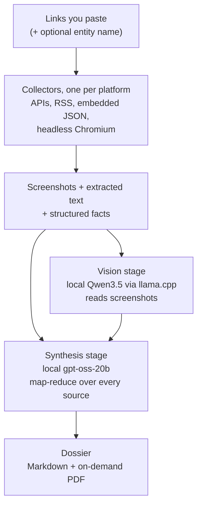

# Creator dossiers: reference

The short version is in the [README](../README.md#creator-dossiers). This page has the details:
which platforms are covered and how, the architecture, and the HTTP API.

---

## Platform coverage

A dedicated collector for every platform in the table, plus a generic Playwright-based fallback
that will politely attempt literally any other website you throw at it.

| Platform | How | Notes |
|---|---|---|
| **YouTube** | Official Data API v3 + free transcript fetch + comments | The one platform with a real, sanctioned API. I treat it like royalty. Without `YOUTUBE_API_KEY` it still works, in a reduced form: the channel's public RSS feed gives the latest videos with descriptions and transcripts, but no channel description, subscriber numbers or comments. The source says "reduced" in its facts when that happens. |
| **GitHub** | REST API | Profile, the top repos by stars (forks left out), languages, followers, the profile README and the READMEs of the top 3 repos. No auth needed; an optional `GITHUB_TOKEN` in `.env` raises the limit from 60 to 5,000 API requests an hour. |
| **Bluesky** | Public AppView API (`bsky.app/profile/<handle>` links) | Name, bio, follower and post counts, and recent posts with their likes and reposts. No login, no key. |
| **LinkedIn** | Parses the JSON-LD Google-SEO blob every public page embeds | Company *and* person pages. Yes, that data is just sitting there in plain sight. |
| **Reddit** | Public `.json` endpoints, with an `old.reddit.com` HTML fallback | Because sometimes the JSON API just 403s you for existing, and old Reddit still answers the door. |
| **Patreon** | Parses the embedded Next.js JSON blob for real membership tiers + prices | This one took real detective work: Patreon hides tier data behind a JSON:API "sideloading" pattern I had to reverse-engineer against a live page. Worth it: real `$3/mo`, `$7/mo` tier pricing, not vibes. |
| **Ko-fi / Buy Me a Coffee** | og-tag scraping + a soft-404 detector | Fun fact: Ko-fi 200s a fake "page" for creators who don't exist instead of a real 404. I catch that so it doesn't get reported as a real profile. Sneaky, Ko-fi. Sneaky. |
| **Instagram / Facebook** | Best-effort logged-out render + og parsing | These platforms *really* don't want anonymous scrapers around, so expect partial data sometimes. That's not a bug, that's Instagram being Instagram. |
| **Medium / Substack** | RSS feeds, one shared collector | The wholesome, well-behaved corner of the internet where scraping is basically just... reading. Keeps up to 4,000 characters of each post and 30,000 per source, newest posts first, so one prolific blog can't drown out everything else. |
| **Linktree / Beacons / stan.store** | Discovers every outbound link on the page | One pasted link-in-bio becomes a full map of everywhere else that creator lives online. Basically a treasure map. |
| **X / Twitter, Twitch** | og-tag based | Logged-out means thin data, but the bio/tagline is real signal. |
| **News** | Auto-attached Google News RSS search for the entity name | Free bonus source. You're welcome. |
| **Everything else** | Generic Playwright render: text + screenshot | The "I got you" fallback. Up to 5 pages per site, and 3 of the site's images go to the vision model. |

Collectors run four at a time (`COLLECT_CONCURRENCY`, each one may open its own Chromium). A
collector that crashes only fails its own source; the error shows on that source's card and the
rest of the job carries on.

---

## Architecture



- **Backend:** FastAPI + a single-worker async job queue. Why single-worker? Because my GPU can
  only hold one model at a time: the vision model and the synthesis model take turns, tag-team
  style, and loading both at once would just set my VRAM on fire. SQLite handles the job store,
  the YouTube quota ledger, and a TTL cache so repeat lookups are free.
- **One lock for the model server.** Creator jobs and company runs started from the browser page
  share one llama-server, so a lock makes them take turns: a creator job waits while a company
  run holds the server, and the other way round. The company command line
  (`python -m backend.company`) is a separate process and does **not** take that lock, so don't
  run it while the web app is busy with a job, or the two will swap models under each other.
- **Restarts are honest.** The queue lives in memory, so a job that was running when the server
  stopped can never finish. At startup such jobs are marked as errors with "interrupted by
  restart" instead of showing as running forever.
- **Scraping:** Playwright (headless Chromium) + httpx + BeautifulSoup. Screenshots feed vision;
  extracted page text feeds synthesis directly (it's usually more accurate than making an AI
  squint at a screenshot).
- **Local AI runtime:** [llama.cpp](https://github.com/ggml-org/llama.cpp)'s `llama-server`,
  CUDA build, running:
  - **Vision:** `Qwen3.5-4B-Q6_K` by default. The original pick was `Qwen3.5-9B-Q8_0`, chosen
    after an actual empirical bake-off against Gemma-4-12B on a real screenshot: Gemma read
    "451 views" as "451K views" and hallucinated a channel called **"PowerDog"** that does not
    exist. Qwen got it right. The 4B model from the same family later read company homepages
    just as exactly, so it is now the default; set `LLM_VISION_MODEL` and `LLM_VISION_MMPROJ` in
    `.env` to go back to the 9B. Descriptions are cached by image, model and prompt for 30
    days, so re-running a job doesn't re-describe the same picture.
  - **Synthesis:** `gpt-oss-20b` at high reasoning effort, because inferring a creator's
    monetization strategy from three sentences of bio text is, unironically, a reasoning task.
    Each source is cut into chunks of up to 20,000 characters, each chunk is summarised, and the
    summaries become one brief per source; the dossier is written from the briefs.
- **When the model comes back empty.** gpt-oss sometimes spends its whole budget thinking and
  returns nothing. An empty reply is retried once at low reasoning effort. A source that still
  yields nothing is named in a note at the end of the dossier (and on its source card), so
  missing content is visible instead of silently dropped. If the dossier itself is still empty,
  the job ends in an error rather than producing a blank document. Separately, the model client
  retries a request once if the connection drops or times out.
- **Quotes are checked against the sources.** Every quotation of three or more words in the
  dossier is compared, word for word (ignoring case and punctuation), with the text that was
  actually collected. A quote that isn't there gets *(unverified: not verbatim in the sources)*
  after it. Be clear about what that means: on 13 stored dossiers it flagged about 1 in 5
  quotes, and many of those were light rewordings of real text, not inventions. The check can't
  tell the two apart, so a flag means "go and look", not "made up". The rest of the grounding
  (confidence levels, using only the briefs) is enforced by the prompt, not by code.
- **Frontend:** Vanilla HTML/CSS/JS. No framework, no build step, no 400MB of `node_modules`
  judging me from a corner. It just works, and I can read all of it in one sitting.
- **Job IDs are sequential and kind of delightful:** the first job is `ABC0001`, then `ABC0002`,
  all the way to `ABC9999`, then it rolls over to `ABD0001` like an odometer, and if I somehow
  run 26³ × 9999 jobs it grows a fourth letter. I'm choosing to believe I will never hit that
  limit. If you do, open an issue, I have questions.

---

## API surface, for the curious / the automators

```
POST /api/jobs                              create a job: {links: [...], entity_name: "..."}
GET  /api/jobs                              list recent jobs
GET  /api/jobs/{id}                         job status + all collected artifacts
GET  /api/jobs/{id}/dossier                 the final Markdown
GET  /api/jobs/{id}/pdf                     server-rendered PDF, generated on demand
GET  /api/jobs/{id}/file?path=...           fetch a screenshot/image from that job's folder

POST /api/company/runs                      start a company report: {name, url, competitors, context,
                                            vision, analysis, bw, social, fresh}
GET  /api/company/runs/{id}                 status of that report
GET  /api/company/reports                   list finished company reports
GET  /api/company/reports/{company}/{date}/report.pdf   (or report.md)
```

The job endpoints answer errors as `{error: {reason, message}}` with a real HTTP status; the
company endpoints answer errors as `{error: "..."}`. The job endpoints (except `/file`) are
rate-limited per IP.

What the server refuses, because it fetches whatever links it's given:

- **Only `http(s)` links to public addresses.** Every creator link, and a company run's `url`,
  is checked when it's submitted: anything that resolves to localhost, a private network or
  another non-public address gets HTTP 400. Known limit: the check happens once, at submit. A
  public site that later redirects to a private address, or a DNS answer that changes after
  the check, is not caught. A host that doesn't resolve at all is let through, and its collector
  reports the failure.
- **Only the `localhost` and `127.0.0.1` Host headers.** Requests with any other Host are
  refused, which stops a web page you visit from reaching the app through DNS rebinding.
- **`/file` serves only files inside that job's folder.** An unknown job id or an absolute path
  gets 404, and so does any path that resolves outside the folder (`..` and the like). The tests
  cover these cases.

The old YouTube pass-through routes from V1 (`/api/resolve`, `/api/channel/...`,
`/api/video/...`, `/api/search`, `/api/quota`, `/api/instagram/...`) are gone. What's left of
`backend/youtube/` (the API client and the link resolver) is used by the YouTube collector.
