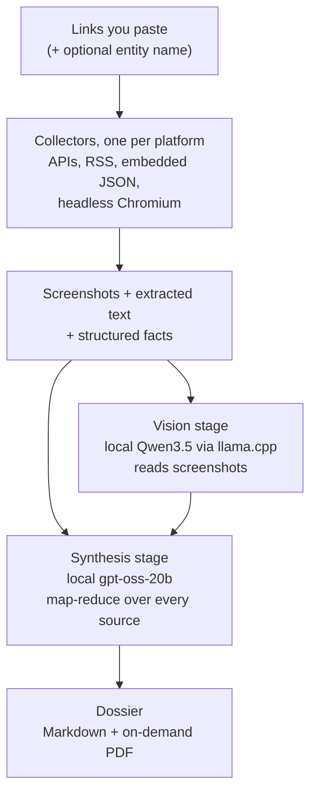

# Creator dossiers: reference

The short version is in the [README](../README.md#creator-dossiers). This page has the details:
which platforms are covered and how, the architecture, and the HTTP API.

---

## Platform coverage

15 dedicated collectors, plus a generic Playwright-based fallback that will politely attempt
literally any other website you throw at it.

| Platform | How | Notes |
|---|---|---|
| **YouTube** | Official Data API v3 + free transcript fetch + comments | The one platform with a real, sanctioned API. I treat it like royalty. |
| **GitHub** | REST API | Repos, READMEs, languages, followers. No auth needed, no drama. |
| **LinkedIn** | Parses the JSON-LD Google-SEO blob every public page embeds | Company *and* person pages. Yes, that data is just sitting there in plain sight. |
| **Reddit** | Public `.json` endpoints, with an `old.reddit.com` HTML fallback | Because sometimes the JSON API just 403s you for existing, and old Reddit still answers the door. |
| **Patreon** | Parses the embedded Next.js JSON blob for real membership tiers + prices | This one took real detective work: Patreon hides tier data behind a JSON:API "sideloading" pattern I had to reverse-engineer against a live page. Worth it: real `$3/mo`, `$7/mo` tier pricing, not vibes. |
| **Ko-fi / Buy Me a Coffee** | og-tag scraping + a soft-404 detector | Fun fact: Ko-fi 200s a fake "page" for creators who don't exist instead of a real 404. I catch that so it doesn't get reported as a real profile. Sneaky, Ko-fi. Sneaky. |
| **Instagram / Facebook** | Best-effort logged-out render + og parsing | These platforms *really* don't want anonymous scrapers around, so expect partial data sometimes. That's not a bug, that's Instagram being Instagram. |
| **Medium / Substack** | RSS feeds | The wholesome, well-behaved corner of the internet where scraping is basically just... reading. |
| **Linktree / Beacons / stan.store** | Discovers every outbound link on the page | One pasted link-in-bio becomes a full map of everywhere else that creator lives online. Basically a treasure map. |
| **X / Twitter, Twitch** | og-tag based | Logged-out means thin data, but the bio/tagline is real signal. |
| **News** | Auto-attached Google News RSS search for the entity name | Free bonus source. You're welcome. |
| **Everything else** | Generic Playwright render: text + screenshot | The "I got you" fallback. |

---

## Architecture



- **Backend:** FastAPI + a single-worker async job queue. Why single-worker? Because my GPU can
  only hold one model at a time: the vision model and the synthesis model take turns, tag-team
  style, and loading both at once would just set my VRAM on fire. SQLite handles the job store,
  the YouTube quota ledger, and a TTL cache so repeat lookups are free.
- **Scraping:** Playwright (headless Chromium) + httpx + BeautifulSoup. Screenshots feed vision;
  extracted page text feeds synthesis directly (it's usually more accurate than making an AI
  squint at a screenshot).
- **Local AI runtime:** [llama.cpp](https://github.com/ggml-org/llama.cpp)'s `llama-server`,
  CUDA build, running:
  - **Vision:** `Qwen3.5-4B-Q6_K` by default. The original pick was `Qwen3.5-9B-Q8_0`, chosen
    after an actual empirical bake-off against Gemma-4-12B on a real screenshot: Gemma read
    "451 views" as "451K views" and hallucinated a channel called **"PowerDog"** that does not
    exist. Qwen got it right. The 4B model from the same family later read company homepages
    just as exactly, so it is now the default; set `LLM_VISION_MODEL` and `LLM_VISION_MMPROJ` in
    `.env` to go back to the 9B.
  - **Synthesis:** `gpt-oss-20b` at high reasoning effort, because inferring a creator's
    monetization strategy from three sentences of bio text is, unironically, a reasoning task.
- **Frontend:** Vanilla HTML/CSS/JS. No framework, no build step, no 400MB of `node_modules`
  judging me from a corner. It just works, and I can read all of it in one sitting.
- **Job IDs are sequential and kind of delightful:** the first job is `ABC0001`, then `ABC0002`,
  all the way to `ABC9999`, then it rolls over to `ABD0001` like an odometer, and if I somehow
  run 26³ × 9999 jobs it grows a fourth letter. I'm choosing to believe I will never hit that
  limit. If you do, open an issue, I have questions.

---

## API surface, for the curious / the automators

```
POST /api/jobs                              create a job: {links: [...], entity_name: "..."}
GET  /api/jobs                              list recent jobs
GET  /api/jobs/{id}                         job status + all collected artifacts
GET  /api/jobs/{id}/dossier                 the final Markdown
GET  /api/jobs/{id}/pdf                     server-rendered PDF, generated on demand
GET  /api/jobs/{id}/file?path=...           fetch a screenshot/image (path-traversal safe, I checked)

GET  /api/resolve?q=...                     raw YouTube channel/video resolution
GET  /api/channel/{id}, /api/video/{id}     full YouTube Data API pass-through (everything public;
                                            also .../videos, /activities, /subscriptions,
                                            /comments, /captions, /api/search)
GET  /api/quota                             live YouTube quota ledger
GET  /api/instagram/{username}              standalone Instagram lookup (feature-flagged)

POST /api/company/runs                      start a company report: {name, url, competitors, context,
                                            vision, analysis, bw, social, fresh}
GET  /api/company/runs/{id}                 status of that report
GET  /api/company/reports                   list finished company reports
GET  /api/company/reports/{company}/{date}/report.pdf   (or report.md)
```

The YouTube endpoints answer `{data, cached, fetched_at, quota}` and their errors
`{error: {reason, message}}`, with a real HTTP status; the company endpoints answer errors as
`{error: "..."}`. Rate-limited, because I like my quota and
assume you like yours too.
